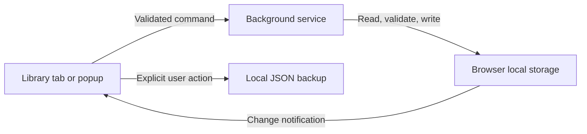

# Architecture

## Boundaries

`config/manifest.base.json` holds shared metadata and privacy policy. `config/targets.ts` selects Chrome's module service worker, Firefox's module event page, and Safari's module event page, plus browser-specific minimum versions. Vite emits a manifest for each target. Chrome stays in `dist`; other builds go under `build`. Packaging uses JavaScript with portable ZIP paths and reproducible archive timestamps.

The runtime adapter in `src/platform/extension.ts` prefers native `browser` APIs on Firefox and Safari and falls back to `chrome` on older Chromium. All supported targets use promise-based MV3 APIs. Chrome-only local storage hardening is feature-detected and is not called on other browsers. See [browser support](browser-support.md) for installation and verification boundaries.

The UI renders plain text with React's escaping. It never uses `innerHTML`, `dangerouslySetInnerHTML`, Markdown rendering, or remote assets. Native modal dialogs provide keyboard focus containment, Escape handling, and focus return. Save failures retain drafts; closing a changed draft asks before discarding it.

The domain layer has no React or browser API dependency. It owns prompt types, strict validation, search, sorting, tag counting, and backup serialization. Add business behavior here before connecting it to platform APIs.

The platform layer handles extension messaging, storage notifications, clipboard interaction in user-initiated card and speed-copy actions, and explicit file operations. WebExtensions local storage is the authoritative durable store. The UI does not write it directly.

The toolbar action declares `popup.html` in the manifest. A separate React entry point provides a compact prompt list, search, tag filter, full-text disclosure, editor, and copy actions. It reuses the library subscription, prompt validation, editor form, and clipboard hook. The full page holds backup tools and broader library management; the popup's **Open full library** button creates an extension-owned tab.

The background entry point registers listeners synchronously and accepts commands only from this extension's exact library and popup URLs. `LibraryService` serializes operations so concurrent views cannot perform overlapping read-modify-write cycles. Every command loads persisted state, so suspension or a worker restart does not discard library data. The in-memory queue is only a coordination mechanism.

The browser closes a popup when it loses focus. The popup writes its draft immediately to WebExtensions session storage, including the original prompt snapshot and revision; it does not debounce writes in the short-lived popup context. Drafts can contain incomplete fields and are validated as drafts when restored. Saving validates the final prompt and checks its revision in the background. The background service clears the session draft after a successful popup save, even if the popup closes before receiving its response. Explicit Cancel offers a native confirmation dialog before discarding changed fields. Drafts last for the browser session and are cleared on restart or extension reload.

The UI re-reads from the background on storage changes. Request sequence numbers prevent stale responses from replacing a later refresh. A prompt revision increments on content or ordinary-tag edits. Assignment-only saves preserve the revision and timestamps; update requests also compare the editor’s original speed-copy slot to reject stale assignment drafts. Update and delete requests include the revision the user saw; stale requests fail with guidance while preserving the draft.

## Data flow

There are no content scripts, external connections, active-tab access, sync storage, or server integrations. Multiple full library tabs are supported. Creating an extension-owned tab does not require the broad `tabs` permission.

## Validation and recovery

Both saved data and imported data are runtime-validated, including field limits, UUIDs, revisions, timestamps, and duplicate IDs. Only recognized properties are retained. Body text is preserved verbatim. Tags use NFC normalization, trimmed lowercase text, and deduplication. User-authored create/update input rejects the reserved standalone `!` tag. Persisted records and backups may contain it, but parsing derives its presence from validated speed-copy assignments.

A single storage write persists each accepted mutation. Validation, count limits, byte limits, revision conflicts, and failed storage operations leave the existing library intact. Unknown schema versions fail closed, without resetting or overwriting saved data. Version 1 is the only current schema; add explicit, tested migrations when a new schema is introduced.

No secrets or prompt contents are written to logs. Errors in the worker log only generic diagnostics. Client errors are visible and actionable.

## Extending the app

- Add new domain behavior with focused tests.
- Add validated commands to `Command` and the background service when writes are required.
- Keep storage behind `StorageAdapter`; introduce IndexedDB if the data model grows beyond a small local collection.
- Add feature UI under `src/features` and reusable primitives under `src/app/components`.
- Keep the manifest's permission list narrow. Website access or remote APIs would be a separate product decision with an explicit permission and privacy review.
- Add version-specific migrations and backup compatibility before changing persisted fields.

The current data limit keeps the single-document storage model practical. Searching and sorting happen in memory; full-text indexing, virtualization, pagination, richer tag management, and synchronization can be added when actual usage calls for them.

## Platform references

- [Chrome storage API](https://developer.chrome.com/docs/extensions/reference/api/storage)
- [Manifest V3 service worker basics](https://developer.chrome.com/docs/extensions/develop/concepts/service-workers/basics)
- [Content security policy](https://developer.chrome.com/docs/extensions/reference/manifest/content-security-policy)
- [Tabs API permissions](https://developer.chrome.com/docs/extensions/reference/api/tabs)
- [Chrome popup lifecycle](https://developer.chrome.com/docs/extensions/develop/ui/add-popup)
- [Playwright extension testing](https://playwright.dev/docs/chrome-extensions)

## Speed-copy

The optional library-level `speedCopy` tuple stores three prompt IDs or nulls. One prompt occupies at most one slot. Creating or updating a prompt can assign, move, or remove its slot in the same serialized storage write. Replacing a slot removes `!` from its old prompt without touching other tags or metadata. Deleting a prompt clears its slot. The marker is allowed in addition to 20 ordinary tags; existing libraries and backups without assignments remain valid. Assigned IDs never require a preexisting marker. Missing markers are added and stray markers removed on parse and after every mutation; the background persists legacy marker repairs once on a library read, preserving prompt metadata. Duplicates remain unassigned and omit `!`.

The shared editor shows `!` as a read-only marker beside speed-copy controls and excludes it from editable ordinary tags. Typing a standalone `!` blocks saving with an explanation, both in the editor and at the background command boundary. The shared editor persists its initial slot and selected slot in popup drafts. A changed selection is applied on Save; unchanged selections do not replace concurrent slot changes. Conflicting prompt assignments preserve the draft and report an error. JSON export includes the mapping, and import restores new IDs into free slots only.

`commands.onCommand` is registered synchronously and reads saved assignments on each shortcut. macOS uses `Command+MacCtrl+Z`, `Command+MacCtrl+X`, and `Command+MacCtrl+C`. Other platforms leave those commands unbound until the user chooses shortcuts. A separate promise queue serializes shortcut copying. Chrome uses a bundled offscreen clipboard document and the `clipboardWrite` and `offscreen` permissions; Firefox and Safari event pages use `navigator.clipboard.writeText` with `clipboardWrite`. Clipboard messages accept only this extension’s background worker. Shortcut failures show a badge and an actionable toolbar title, without logging prompt content. There is no clipboard-read permission or website access.

References: [Commands and macOS modifiers](https://developer.chrome.com/docs/extensions/reference/api/commands), [offscreen clipboard documents](https://developer.chrome.com/docs/extensions/reference/api/offscreen), and [extension clipboard permissions](https://developer.mozilla.org/en-US/docs/Mozilla/Add-ons/WebExtensions/Interact_with_the_clipboard).
